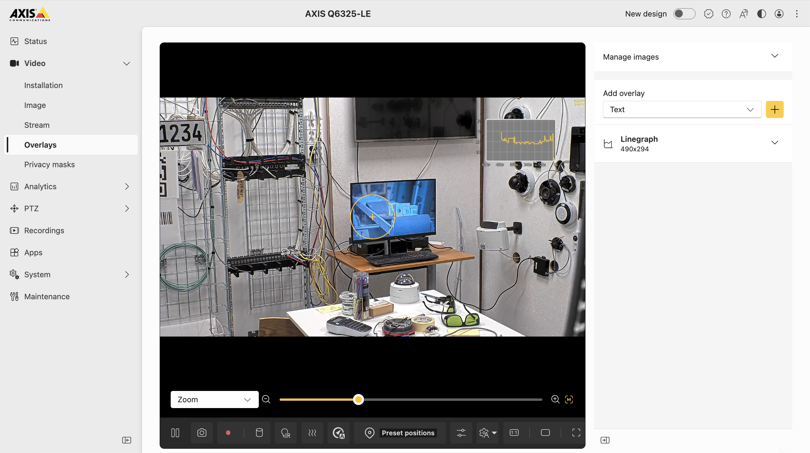

# CPU Usage on Overlay

## How It Works

## Why Choose This Approach?

With the FixedIT Data Agent, you can create your own edge-based workflows and automations that run directly in the Axis devices. You can do this without knowing anything about the Axis [ACAP SDK](https://www.axis.com/for-developers/acap), C and C++ programming. This makes the edge available to a much wider audience of developers, system integrators and IT professionals.

This project shows how to get a value from the device into the video itself. Telegraf reads the CPU usage, and the `exec` output passes it to a small shell script that updates an overlay through the camera's VAPIX API. The same pattern works for any value you can collect with Telegraf, such as memory usage.

## Table Of Contents

## Compatibility

### AXIS OS Compatibility

- **Minimum AXIS OS version**: AXIS OS 12.0. (earliest working version tested is AXIS OS 12.11.77, on the platofrm ARTPEC-8. Older versions was also tested but they weren't compatible).
- **Required hardware**: A camera with the ARTPEC-8 or ARTPEC-9 platform (required for the linegraph overlay widget to work). Tested on multiple ARTPEC-7 and earlier platforms but without sucess.
- **Required tools**: Uses `curl` to send requests to the VAPIX Dynamic Overlay API with Digest Authentication. Uses standard Unix utilities and POSIX shell (`sh`) to execute the helper script.

### FixedIT Data Agent Compatibility

- **Minimum Data Agent version**: 1.5.0, because of the `serializers.template` serializer.
- **Required features**: Uses the `inputs.cpu`, `outputs.file` and `outputs.exec` plugins, the `serializers.template` serializer, the `HELPER_FILES_DIR`, `VAPIX_USERNAME` and `VAPIX_PASSWORD` environment variables, and support for uploading and executing helper shell scripts.

## Quick Setup

1. Disable the bundled configuration files under Configuration->Files.
2. Upload and enable all `.conf` files under Configuration->Files by pressing the "Upload Config" button and then "Enable" next to the uploaded file.
3. Upload `set_overlay_text.sh` by pressing the "Upload helper file" button and mark it as "Make Executable".
4. Unselect the "Clear all values" slider under the "VAPIX credentials" section and input the username and password of a VAPIX account that has at least operator access.
5. Verify that you see blue lines in the "Logs" tab with the current CPU usage.
6. Go to the camera's Video->Overlays tab and add a new "Linegraph" overlay widget, configure it to use `#D1` as data source.

## Files

## Configuration Details
