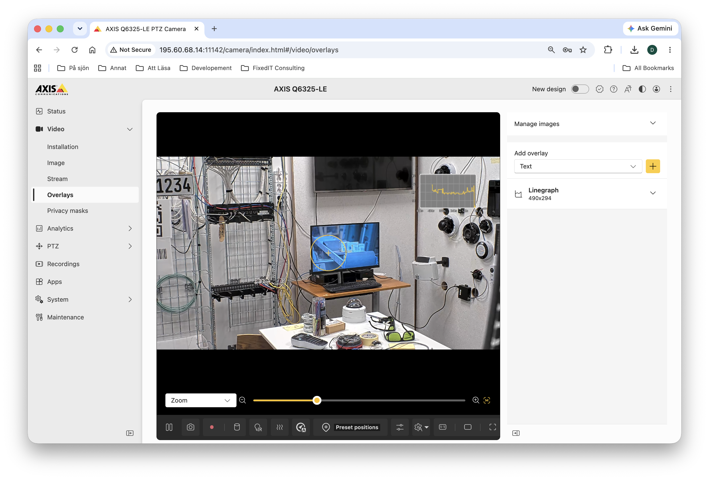

# CPU Usage on Overlay

1. Upload and enable all `.conf` files under Configuration->Files by pressing the "Upload Config" button and then "Enable" next to the uploaded file.
2. Upload `set_overlay_text.sh` by pressing the "Upload helper file" button and mark it as "Make Executable".
3. Unselect the "Clear all values" slider under the "VAPIX credentials" section and input the username and password of a VAPIX account that has at least operator access.
4. Verify that you see blue lines in the "Logs" tab with the current CPU usage.
5. Go to the camera's Video->Overlays tab and add a new "Linegraph" overlay widget, configure it to use `#D1` as data source.

