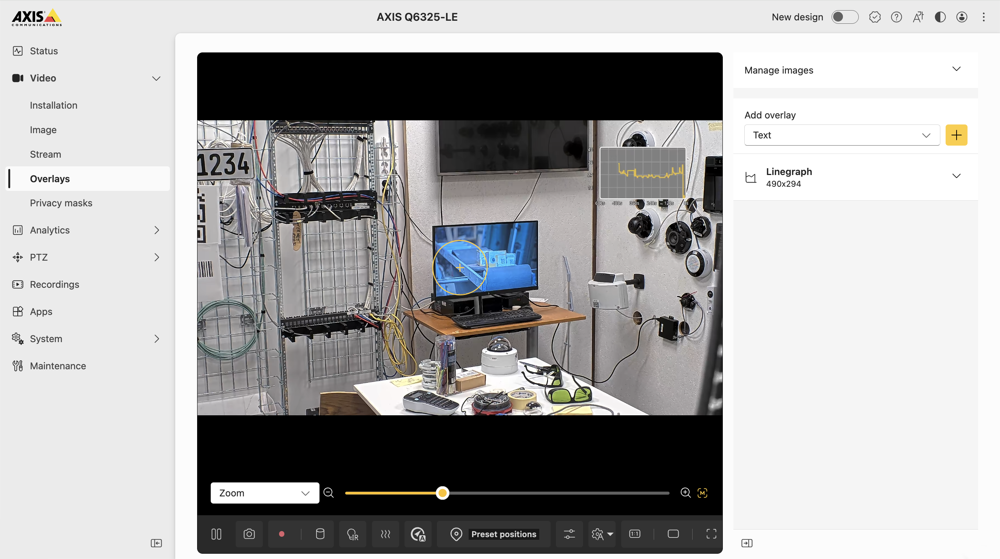

# CPU Usage on Overlay

## How It Works

## Why Choose This Approach?

## Table Of Contents

## Compatibility

## Quick Setup

1. Disable the bundled configuration files under Configuration->Files.
2. Upload and enable all `.conf` files under Configuration->Files by pressing the "Upload Config" button and then "Enable" next to the uploaded file.
3. Upload `set_overlay_text.sh` by pressing the "Upload helper file" button and mark it as "Make Executable".
4. Unselect the "Clear all values" slider under the "VAPIX credentials" section and input the username and password of a VAPIX account that has at least operator access.
5. Verify that you see blue lines in the "Logs" tab with the current CPU usage.
6. Go to the camera's Video->Overlays tab and add a new "Linegraph" overlay widget, configure it to use `#D1` as data source.

## Files

- `config_agent.conf`: Contains the global Telegraf agent configuration, including collection and flush intervals.
- `config_input_cpu.conf`: Configures the collection of total CPU usage.
- `config_output_logs.conf`: Configures the output of CPU usage data to the FixedIT Data Agent logs.
- `config_output_overlay.conf`: Configures the output of CPU usage data to the camera's dynamic overlay.
- `set_overlay_text.sh`: Helper script that updates the dynamic overlay text using the VAPIX API.

## Configuration Details

