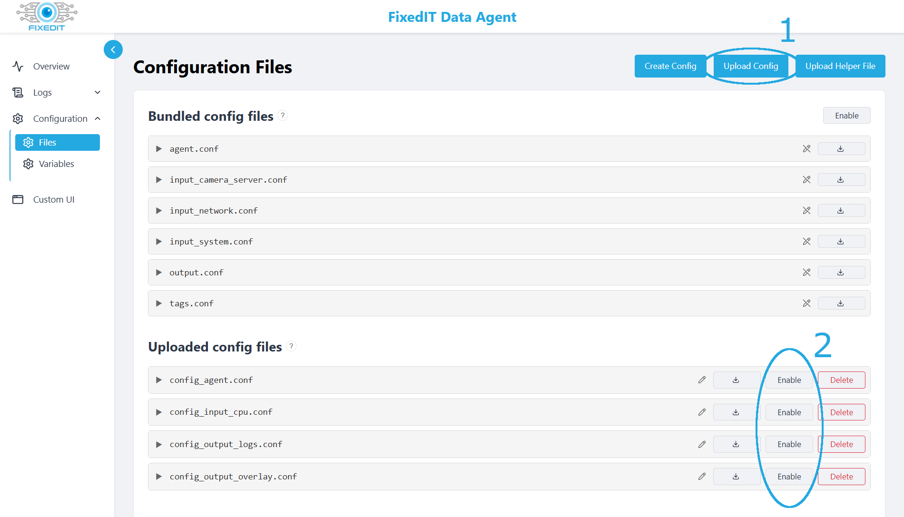
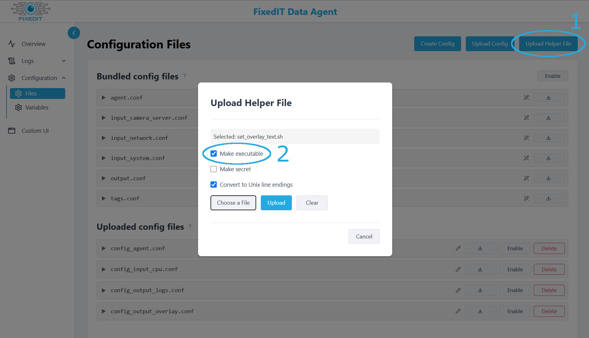
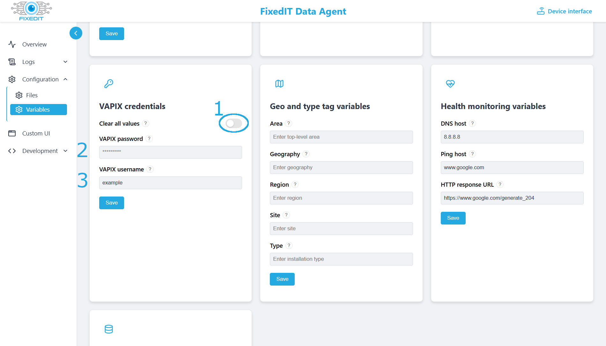

# CPU Usage on Overlay

## How It Works

## Why Choose This Approach?

## Table Of Contents

## Compatibility

## Quick Setup

1. Disable the bundled configuration files under `Configuration->Files`.

   

2. Upload and enable all `.conf` files under `Configuration->Files` by pressing the "Upload Config" button and then "Enable" next to the uploaded file.

   

3. Upload `set_overlay_text.sh` by pressing the "Upload helper file" button and mark it as "Make Executable". Leave "Convert to Unix line endings" checked.

   

4. Under `Configuration->Variables`, turn off the "Clear all values" slider in the "VAPIX credentials" section, enter the username and password of a VAPIX account with at least operator access, and press "Save".

   

5. Open `Logs->Pipeline Data` and check that a line with the current CPU usage appears once per interval. The interval is `SYNC_INTERVAL_SECONDS` under `Configuration->Variables` (60 seconds by default). The first overlay update can take about two intervals: the first CPU sample establishes a baseline, and the second lets the plugin calculate usage from the change between samples ([see `config_agent.conf`](config_agent.conf#L4-L6)).

   

6. In the camera's `Video->Overlays` tab, add a "Linegraph" overlay widget and set its data source to `#D1`. For details about the `#D1` modifier and how it is selected, see [How It Works](#how-it-works). If "Linegraph" is not available, see [Compatibility](#compatibility). It may require a newer AXIS OS version or a camera SoC that supports widgets.

   

7. After one to two sync intervals, open the live view and confirm that the CPU
   usage is displayed in the Linegraph overlay. With the default
   `SYNC_INTERVAL_SECONDS` value, this normally takes up to two minutes.

## Files

## Configuration Details
