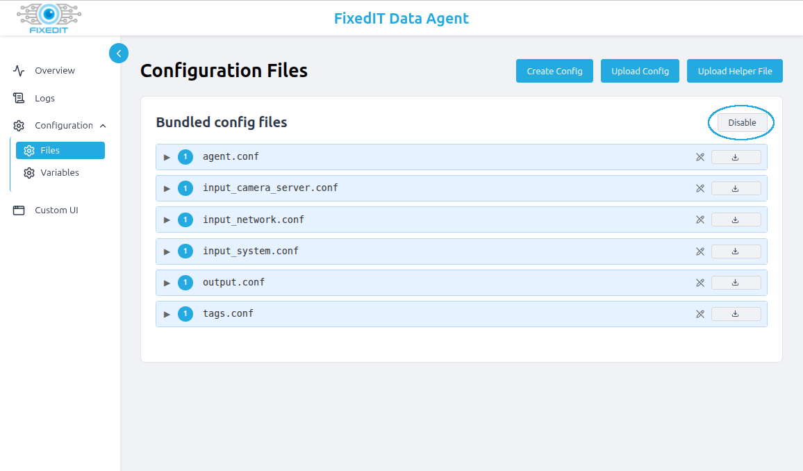
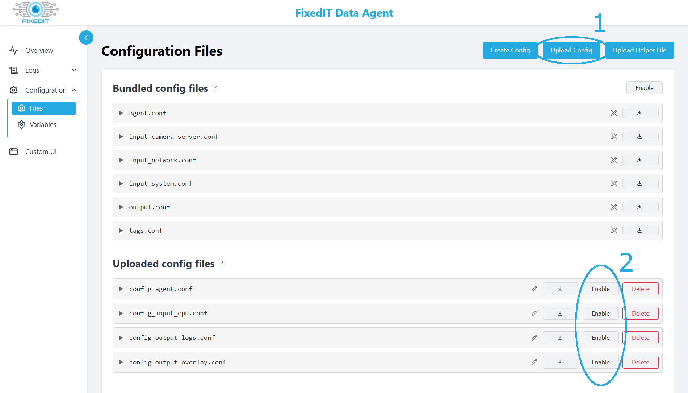
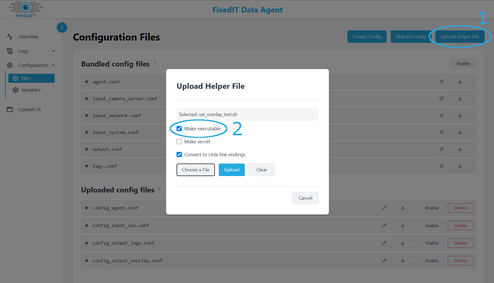
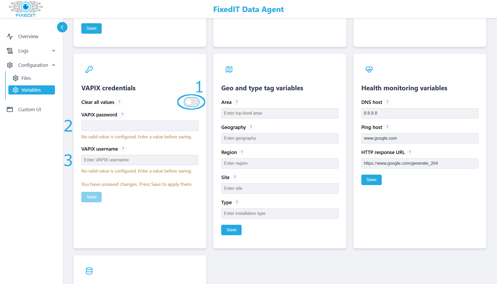
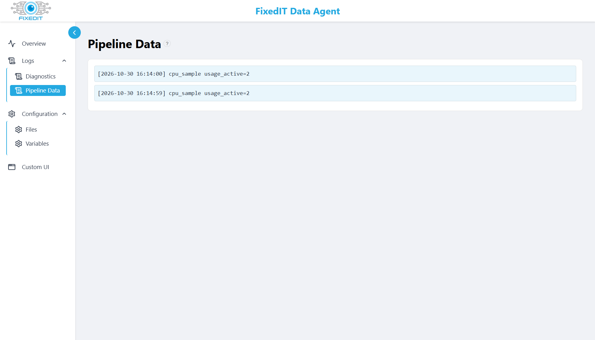

# CPU Usage on Overlay

## Quick Setup

1. Disable the bundled configuration files under `Configuration->Files`.

2. Upload and enable all `.conf` files under `Configuration->Files` by pressing the "Upload Config" button and then "Enable" next to the uploaded file.

3. Upload `set_overlay_text.sh` by pressing the "Upload helper file" button and mark it as "Make Executable". Leave "Convert to Unix line endings" checked.

4. Under `Configuration->Variables` select the "Clear all values" slider under the "VAPIX credentials" section and input the username and password of a VAPIX account that has at least operator access.

5. Verify that you see blue lines in the `Logs->Pipeline Data` tab with the current CPU usage.

6. Go to the camera's `Video->Overlays` tab and add a new "Linegraph" overlay widget, configure it to use `#D1` as data source.

