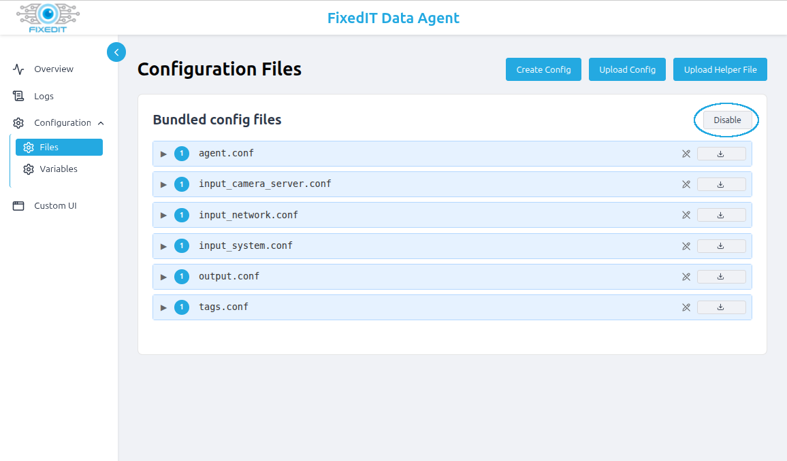
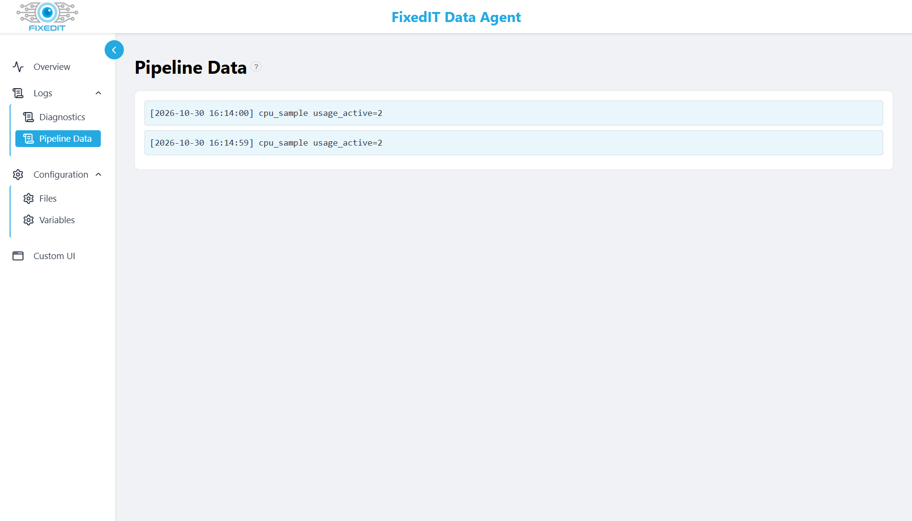

# CPU Usage on Overlay

## How It Works

## Why Choose This Approach?

## Table Of Contents

## Compatibility

## Quick Setup

1. Disable the bundled configuration files under `Configuration->Files`.

   

2. Upload and enable all `.conf` files under `Configuration->Files` by pressing the "Upload Config" button and then "Enable" next to the uploaded file.

   

3. Upload `set_overlay_text.sh` by pressing the "Upload helper file" button and mark it as "Make Executable". Leave "Convert to Unix line endings" checked.

   

4. Under `Configuration->Variables`, turn off the "Clear all values" slider in the "VAPIX credentials" section, enter the username and password of a VAPIX account with at least operator access, and press "Save".

   

5. Open `Logs->Pipeline Data` and check that a line with the current CPU usage appears once per interval. The interval is `SYNC_INTERVAL_SECONDS` under `Configuration->Variables` (60 seconds by default). The first line can take up to two intervals, because the CPU plugin needs two samples before it can report a percentage.

   

6. In the camera's `Video->Overlays` tab, add a "Linegraph" overlay widget and set its data source to `#D1`. The modifier is set in `config_output_overlay.conf`.

   

## Files

## Configuration Details
