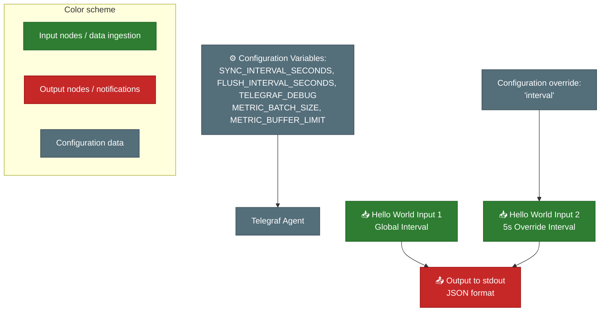
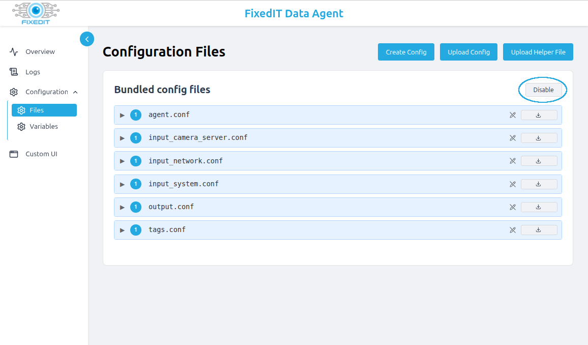
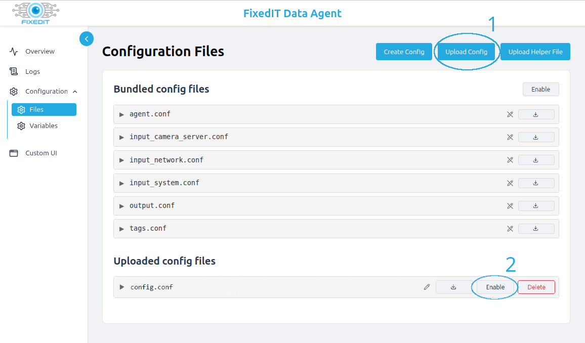
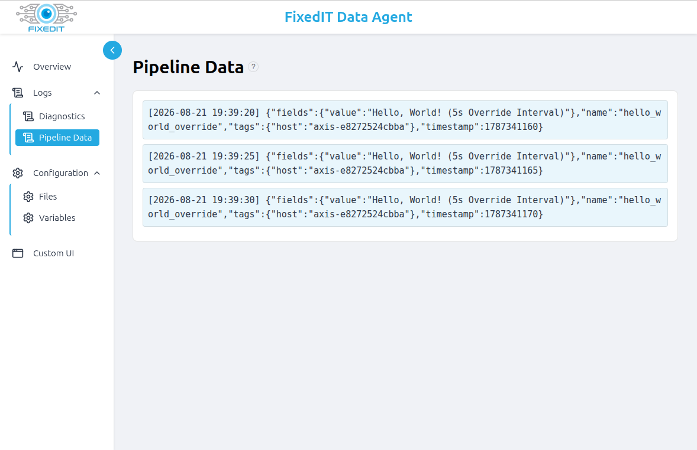
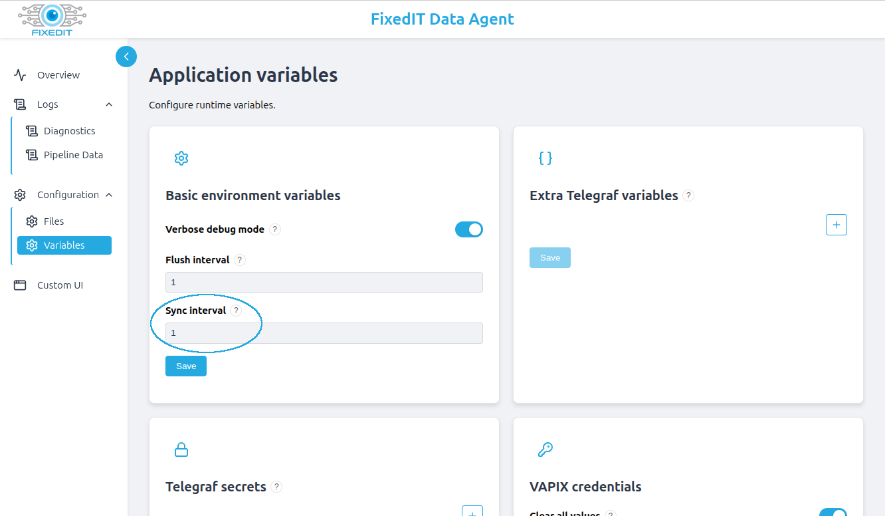
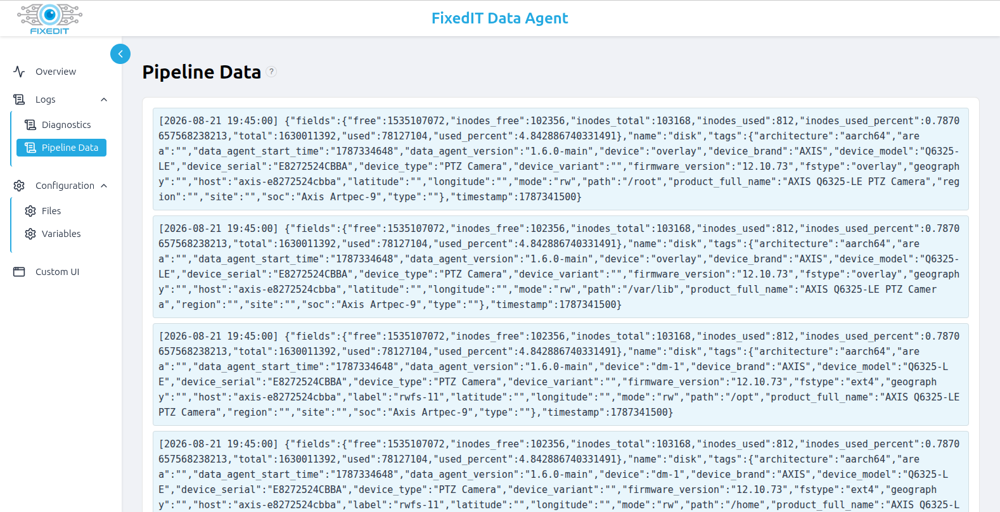
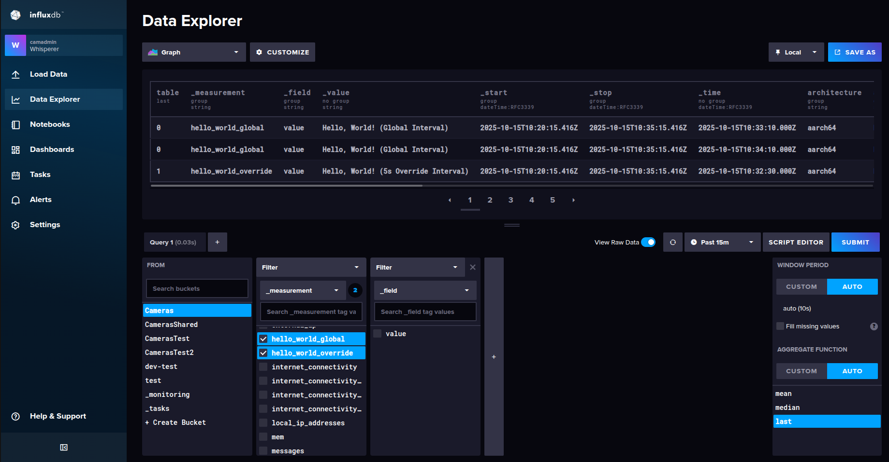
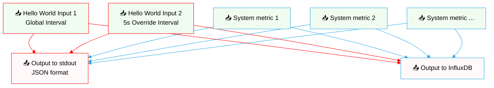

# Hello, World! (with exec input plugin)

This is a simple "Hello, world!" project that demonstrates how to use the [FixedIT Data Agent](https://fixedit.ai/products-data-agent/) to print messages to the standard output of the Telegraf process, which will be captured by the FixedIT Data Agent and displayed in the `Logs->Pipeline Data` tab.

This is very similar to the [project-hello-world](../project-hello-world/) project, but instead of using the `inputs.mock` plugin to generate the input data, we are using the `inputs.exec` plugin to run a shell command. This guide also adds the [Running the Example Together with the Default Config Files](#running-the-example-together-with-the-default-config-files) section to show how to send the data to an InfluxDB database and use it there.

<details>
<summary><strong> What is Telegraf? </strong></summary>
Telegraf is an open-source agent for collecting, processing, and sending metrics and other data using a plugin-based architecture.
</details>

## How It Works

### Step - 1
#### Inputs generate data.

This project defines two inputs that will run on an interval and produce a "Hello, World!" message. We make use of the `inputs.exec` plugin to run the `echo` command which will output the message.

One input runs on the globally configured interval.

The other input runs on a more frequent interval.

### Step - 2

The `outputs.file` plugin is used to print all metrics to the standard output of the Telegraf process.

### Step - 3

The standard output of the Telegraf process will be captured by the FixedIT Data Agent and displayed in the `Logs->Pipeline Data` tab.

---



## Why Choose This Approach?

With the FixedIT Data Agent, you can create your own edge-based workflows and automations that run directly in the Axis devices. You can do this without knowing anything about the Axis ACAP SDK, C and C++ programming. This makes the edge available to a much wider audience of developers, system integrators and IT professionals.

This simple project demonstrates how to configure different inputs with different intervals in the FixedIT Data Agent and how to propagate that data to the `Logs->Pipeline Data` tab of the FixedIT Data Agent. It's a great starting point for understanding the basics of the agent's configuration system.

---

<details>
<summary><strong> What is ACAP? </strong></summary>
ACAP (Axis Camera Application Platform) lets you build custom applications that run directly on Axis devices, such as cameras, intercoms and speakers.
</details>

---

<details>
<summary><strong> What is an SDK? </strong></summary>
An SDK (Software Development Kit) is a package of tools, code libraries, documentation and examples that help programmers build software for a specific platform.
</details>

## Table of Contents

<details open>
<summary><strong> Show / Hide Table </strong></summary>

<!-- toc -->

- [Compatibility](#compatibility)
  - [AXIS OS Compatibility](#axis-os-compatibility)
  - [FixedIT Data Agent Compatibility](#fixedit-data-agent-compatibility)
- [Quick Setup](#quick-setup)
- [Files](#files)
- [Configuration Details](#configuration-details)
- [Running the Example Together with the Default Config Files](#running-the-example-together-with-the-default-config-files)
- [Advanced: Local Testing on Host](#advanced-local-testing-on-host)
  - [Prerequisites](#prerequisites)
  - [Test Commands](#test-commands)

<!-- tocstop -->

</details>

## Compatibility

### AXIS OS Compatibility

- **Minimum AXIS OS version**: No special requirements
- **Required tools**: None

### FixedIT Data Agent Compatibility

- **Minimum Data Agent version**: 1.1
- **Required features**: `SYNC_INTERVAL_SECONDS` and `FLUSH_INTERVAL_SECONDS` environment variables (added in FixedIT Data Agent v1.1).

## Quick Setup

1. **Disable the default config files**

   The FixedIT Data Agent comes with default config files for collecting system metrics and sending them to a database. Since we don't want to use those now, click the `Disable` button next to the "Bundled config files" in the "Configuration" tab of the FixedIT Data Agent.

   

2. **Upload and enable the `config.conf` file to the FixedIT Data Agent**

   Click the `Upload Config` button in the "Configuration->Files" tab of the FixedIT Data Agent and upload the `config.conf` file. Then press the `Enable` button next to the `config.conf` file.

   

3. **Go to the "Logs->Pipeline Data" tab and verify the metrics**

   It might take a few seconds before Telegraf has been restarted with the new config file. After this, you should see the metrics appearing as JSON in the "Logs->Pipeline Data" tab at two different intervals:
   - The `hello_world_override` metric with `"Hello, World! (5s Override Interval)"` in the `value` field every 5 seconds
   - The `hello_world_global` metric with `"Hello, World! (Global Interval)"` in the `value` field every 60 seconds

   

4. **Reconfigure the FixedIT Data Agent variables:**

   The `config.conf` file is making use of the `SYNC_INTERVAL_SECONDS`, `FLUSH_INTERVAL_SECONDS` and
   `TELEGRAF_DEBUG` environment variables which are by default set by the FixedIT Data Agent and controlled
   from the form in the "Basic environment variables" section in the "Configuration->Variables" tab. See the [project-hello-world](../project-hello-world/) example for more details.

   Try changing the "Sync interval" to 1 second in the "Configuration->Variables" tab.

   

   When inspecting the "Logs->Pipeline Data" tab again, you should now see the global interval message appearing every second instead.

## Files

- `config.conf`: Combined configuration file containing both inputs and the output configuration.

## Configuration Details

The project uses the following components:

1. **Input Configurations**
   - Global interval input: Uses the `exec` input plugin to run an `echo` command every `SYNC_INTERVAL_SECONDS` seconds, producing a `hello_world_global` metric.
   - Override interval input: Same as above, but every 5 seconds regardless of the value of the `SYNC_INTERVAL_SECONDS` variable, producing a `hello_world_override` metric.

2. **Output Configuration**
   - Uses the `file` output plugin configured to write to `stdout`.
   - The output data format is set to `json`.

3. **Data Flow**
   - Since the output plugin does not specify any filters, it will consume all metrics produced by both input plugins.

## Running the Example Together with the Default Config Files

One of the steps in the quick setup was to disable the default config files. The reason for doing this is that the default behavior of Telegraf is to connect all inputs to all outputs. You can upload the same config file to the FixedIT Data Agent while having the bundled config files enabled. This will work assuming that you have already configured the InfluxDB variables according to the `QUICKSTART_GUIDE.pdf` guide for the FixedIT Data Agent.

When doing this, you will see a lot of output in the "Logs->Pipeline Data" tab. This is because your new "output everything to stdout" plugin will consume all metrics from all configuration files and print all of them to stdout.



The same is true for the new inputs that you created, the "Hello, World!" messages will also be sent to InfluxDB using the output defined in the bundled config files.



All inputs are sent to all outputs. 

- Bundled plugins - blue border.
- New plugins - red border.



## Advanced: Local Testing on Host

As your projects grow, it can be valuable to try changes on your computer first rather than uploading every tweak to the Axis device. Doing so requires a bit more setup, so you might want to skip this section until later.

### Prerequisites

- Requires Linux: since this example makes use of the `inputs.exec` plugin to run shell commands, it will only work on Linux (or WSL under Windows). For a simple Windows example, see [project-hello-world](../project-hello-world/).
- Install Telegraf on your development machine.

### Test Commands

On the Axis device, the FixedIT Data Agent sets `SYNC_INTERVAL_SECONDS`, `FLUSH_INTERVAL_SECONDS`, and `TELEGRAF_DEBUG` for you. When running Telegraf on your host, export those variables first. On Linux:

```bash
export SYNC_INTERVAL_SECONDS="1"
export FLUSH_INTERVAL_SECONDS="1"
export TELEGRAF_DEBUG="true"
```

Then run Telegraf with the configuration file:

```bash
telegraf --config config.conf --non-strict-env-handling
```

You should now see some internal Telegraf logs on `stderr` and JSON metrics on `stdout`, including `hello_world_global` every `SYNC_INTERVAL_SECONDS` seconds and `hello_world_override` every 5 seconds.
