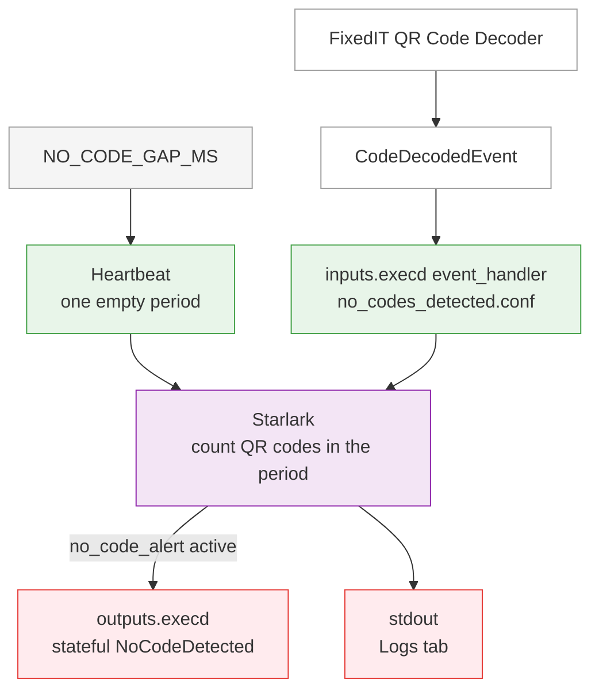

# No QR Codes on a Conveyor

This project watches a conveyor with the [FixedIT Data Agent](https://fixedit.ai/products-data-agent/) and the [FixedIT QR Code Decoder](https://fixedit.ai/products-acaps/). Every decoded QR code counts. The heartbeat interval is `NO_CODE_GAP_MS` (1000 milliseconds when unset). One full interval with no QR code sets a stateful Axis event to active.

The event stays active until another code is decoded, which sets it back to inactive. Only those changes are sent.

## How It Works

Color scheme:

- Light green: Input nodes / data ingestion
- Purple: Processor nodes
- Red: Output nodes
- Light gray: Environment variables
- White: External systems

## Table of Contents

<!-- toc -->

- [Compatibility](#compatibility)
  - [AXIS OS Compatibility](#axis-os-compatibility)
  - [FixedIT Data Agent Compatibility](#fixedit-data-agent-compatibility)
- [Quick Setup](#quick-setup)

<!-- tocstop -->

## Compatibility

### AXIS OS Compatibility

- **Minimum AXIS OS version**: No specific version required.
- **Required tools**: None beyond the FixedIT QR Code Decoder ACAP.

### FixedIT Data Agent Compatibility

- **Minimum Data Agent version**: 1.7.0
- **Required features**: `event_handler` subscribe which was added in version 1.7.0.

## Quick Setup

1. Install the FixedIT QR Code Decoder and the FixedIT Data Agent on the camera. Point the camera at the conveyor so QR codes pass through the decoder's view.
2. Optional: under Configuration->Variables, add an Extra Telegraf variable `NO_CODE_GAP_MS`. That number is the heartbeat interval in milliseconds. One interval with no QR code raises the alert. When unset, the interval is 1000 milliseconds.
3. In the FixedIT Data Agent, under Configuration->Files, disable the bundled configuration files.
4. Upload `no_codes_detected.conf` and enable it.
5. Open Logs->Pipeline Data. After the configured gap with no QR code, a `no_code_alert` metric appears with `"active": true`. The next QR code produces `"active": false`.

Then create an overlay to show the alert on the video stream:

1. Go to the camera's System->Events tab and create a new rule with the "FixedIT No QR Code" event as a condition. Select the "Use overlay text while the rule is active" action. Set a text like "NO CODES DETECTED!".
2. Go to the camera's Video->Overlays tab and add a new "Text" overlay widget, configure it to use `#D` as data source.
