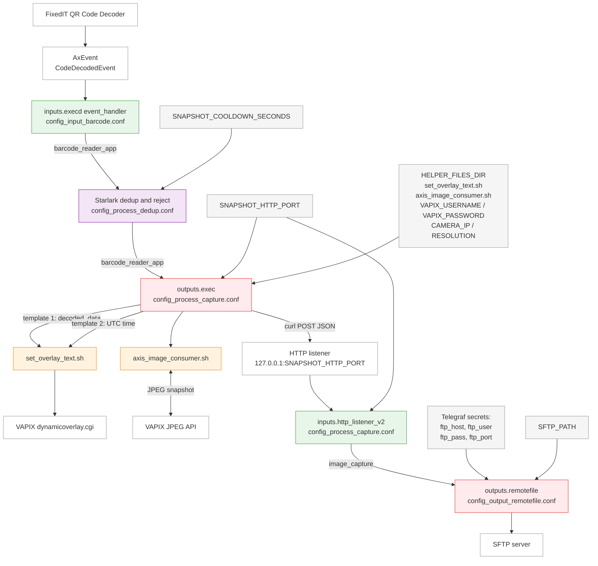

# QR Code Snapshot Upload to SFTP

This project shows how to react to [FixedIT QR Code Decoder](https://fixedit.ai/products-acaps/) detections on an Axis camera with the [FixedIT Data Agent](https://fixedit.ai/products-data-agent/): when a QR code is read in the live view, the workflow immediately grabs a JPEG snapshot from the same camera and uploads it to an SFTP server. Images are grouped by decoded QR value, for example `/cameras/SHIPMENT-ABC123/20250614T153045Z.jpg`.

The decoder and the Data Agent run on the same device. Detections arrive as Axis events (`CodeDecodedEvent`) consumed with `event_handler --subscribe`. A short cooldown suppresses multiple uploads while the same code remains visible in frame.

## How It Works



Color scheme:

- Light green: Input nodes / data ingestion
- Purple: Processor nodes
- Orange: Helper scripts
- Red: Output nodes
- Light gray: Environment variables and secrets
- White: External systems

## Why Choose This Approach?

This shows how to build a system for "digital threads" that is simple to deploy and maintain. Objects marked with IDs can be photographed at different stages in a process, then uploaded and organized into folders on an SFTP server. The only component that needs deployment apart from the camera applications is a regular SFTP server (like [SFTPgo](https://sftpgo.com/)) that any IT admin would be happy to manage. There are no subscription fees or SaaS services.

## Table of Contents

<!-- toc -->

- [Compatibility](#compatibility)
  - [AXIS OS Compatibility](#axis-os-compatibility)
  - [FixedIT Data Agent Compatibility](#fixedit-data-agent-compatibility)
- [Quick Setup](#quick-setup)
- [Troubleshooting](#troubleshooting)
- [How does it work?](#how-does-it-work)
  - [Reading detections as events](#reading-detections-as-events)
  - [Capture using base64-encoded image](#capture-using-base64-encoded-image)
  - [Sending the image snapshot over HTTP](#sending-the-image-snapshot-over-http)
  - [Obfuscating the FTP password](#obfuscating-the-ftp-password)
- [Files](#files)
- [Configuration Details](#configuration-details)
- [Known Limitations](#known-limitations)

<!-- tocstop -->

## Compatibility

### AXIS OS Compatibility

- **Minimum AXIS OS version**: AXIS OS 12.0. Uses `jq` which was not available in some older AXIS OS versions.
- **Required tools**: `curl`, `jq`, and `openssl`

### FixedIT Data Agent Compatibility

- **Minimum Data Agent version**: 1.6.0
- **Required features**: Uses the `secretstores.os` plugin added in FixedIT Data Agent 1.6.0. Also uses the template serializer added in FixedIT Data Agent 1.5.0.

## Quick Setup

1. **Install ACAPs** on the camera: FixedIT QR Code Decoder and FixedIT Data Agent.

2. **Set Data Agent parameters** in the UI:

   - **VAPIX username / password**: credentials for snapshot capture (viewer account is enough).
   - **Telegraf secrets** (Configuration->Variables->Telegraf secrets): add the four secrets used by `config_output_remotefile.conf`. NOTE: for the `ftp_pass`, you have to mark the "Obfuscate for remotefile" checkbox when setting the secret.

     | Secret name | Example value       |
     | ----------- | ------------------- |
     | `ftp_host`  | `sftp.example.com`  |
     | `ftp_user`  | `camera_upload`     |
     | `ftp_pass`  | Obfuscated password |
     | `ftp_port`  | `22`                |

   - **Extra env** (optional overrides; defaults apply if omitted):

     ```txt
     SFTP_PATH=/cameras;SNAPSHOT_COOLDOWN_SECONDS=30
     ```

     | Variable                    | Default    | Purpose                                               |
     | --------------------------- | ---------- | ----------------------------------------------------- |
     | `SFTP_PATH`                 | `/cameras` | Remote base directory on the SFTP server              |
     | `SNAPSHOT_COOLDOWN_SECONDS` | `30`       | Minimum seconds between uploads for the same QR value |
     | `SNAPSHOT_HTTP_PORT`        | `18081`    | Localhost port for the snapshot HTTP listener         |

3. **Upload helper files** (mark `.sh` scripts executable in the UI):

   - `set_overlay_text.sh`
   - `axis_image_consumer.sh`

4. **Upload and enable these configs:**
   1. `config_input_barcode.conf`
   2. `config_process_dedup.conf`
   3. `config_process_capture.conf`
   4. `config_output_remotefile.conf`

   The order in which the configuration files are loaded does not matter since the processors use the `order:` option to define explicit load order.

## How does it work?

### Reading detections as events

`config_input_barcode.conf` uses the bundled `event_handler` binary in subscribe mode to consume the `CodeDecodedEvent` events that are sent by the FixedIT QR Code Decoder ACAP app. The decoded payload is the event item `value`. A rename processor in the same config maps that field to `decoded_data` before the rest of the pipeline to keep the naming consistent with examples that use the socket reader plugin.

There are other ways that QR codes can be read from the FixedIT QR Code Decoder ACAP app. In some other projects you will see that the socket reader plugin is used instead. The benefit of using the socket reader instead of the event bus is that the socket can buffer the detections so that no detections are lost if the FixedIT Data Agent would be temporarily stopped. In this project, buffering of detections does, however, not make sense since we need to capture a synchronized image snapshot for the detection to be valuable.

### Capture using base64-encoded image

Since Telegraf does not support binary data in the messages, we need to encode the image as a base64-encoded string. This is done by the capture script (similar to the [timelapse project](../project-timelapse-s3/)). The image is then unpacked to a binary JPEG file again in the `remotefile` output using the `data_format = "template"` and `b64dec` serializer.

### Sending the image snapshot over HTTP

One important aspect to note is that we POST the image snapshot from the capture script to a localhost HTTP listener. It would be more straightforward to use a `processors.execd` plugin to enrich the QR code message with the snapshot. However, the `processors.execd` plugin has a limit on the size of the stdout buffer, which can be a problem if the image is large. Therefore, we are instead using an `outputs.exec` plugin to run the capture script, and `curl` to POST the JSON body to `inputs.http_listener_v2` on `127.0.0.1`. Binding it to `127.0.0.1` keeps the endpoint off the network, so it does not need authentication.

### Obfuscating the FTP password

The `rsync` library used in the `remotefile` output only accepts obfuscated passwords for the sftp server. Therefore, when saving the password as a secret, you need to mark the "Obfuscate for remotefile" checkbox. This makes sure that an obfuscated version of the password is stored in the secrets store.

## Files

- `config_input_barcode.conf`: Subscribes to `CodeDecodedEvent` and renames the payload field `value` to `decoded_data`
- `config_process_dedup.conf`: Drops repeat reads of the same code during the cooldown
- `config_process_capture.conf`: Updates the overlay, fetches a JPEG, and re-ingests it through a localhost HTTP listener
- `set_overlay_text.sh`: Script used to set dynamic overlay templates #D1 and #D2 through the VAPIX dynamic overlay API
- `axis_image_consumer.sh`: Script used to fetch a JPEG from the camera VAPIX API and print it as base64 JSON
- `config_output_remotefile.conf`: Uploads each JPEG to SFTP, in a folder named after the decoded value

## Known Limitations

The QR code deduplication is intended for a single QR code being visible at a time. If multiple QR codes are visible at the same time, the deduplication will jump between the codes and let each detection trigger a new upload. If this is a problem, you can change the state in the [./config_process_dedup.conf](config_process_dedup.conf) file to use a dict of QR code values instead of a single value.
